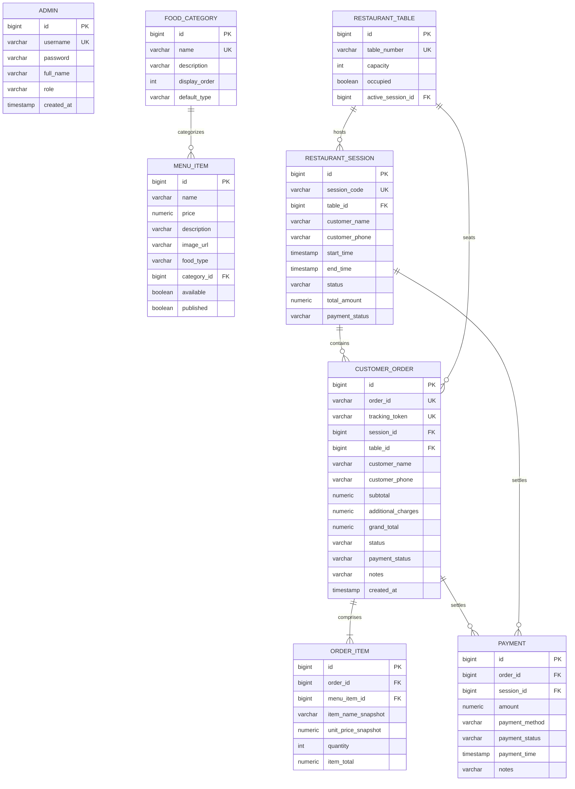

# Shubdum Chinese Corner & Indian Kitchen
### Complete Restaurant Food Ordering & Management System

> **Location:** Thane East, Maharashtra, India  
> **Google Business Listing:** [https://share.google/eSXsF3SXNVLvtKeSu](https://share.google/eSXsF3SXNVLvtKeSu)  
> **Default Admin Credentials:** Username: `admin` | Password: `admin123`

---

## 1. System Overview

**Shubdum Chinese Corner & Indian Kitchen** is a full-stack, responsive, production-ready restaurant digital food ordering and live management platform. It delivers a fast dining experience for customers and a comprehensive management back-office for restaurant staff and management.

### Two Distinct User Experiences

1. **Customer Direct Access (Strictly NO Login / NO Registration):**
   - Customers **never** create accounts or log in.
   - Customers scan a QR code or open the website, select their dining style (**VEG** or **NON-VEG**), browse the menu, customize portions, enter their name and mobile number, select their table (**Table 01 to Table 10**), and place their order.
   - Receives a **unique Order ID** (e.g. `SHB-1001`) and a cryptographically secure **tracking token** (UUID) to track their order live.

2. **Admin & Staff Management (Secure Authentication):**
   - Protected with **Spring Security**, **BCrypt** password encryption, and **JWT (JSON Web Tokens)**.
   - Real-time incoming orders with audio/visual notification chime over **WebSocket (STOMP)**.
   - Full order lifecycle approval pipeline: `PENDING → APPROVED → PREPARING → READY → SERVED → COMPLETED` (or `REJECTED`).
   - **Table-wise billing** supporting multiple orders per dining session into a combined master bill.
   - **OpenPDF** tax invoice generation for individual orders and combined table bills.
   - Cash payment management (`PAYMENT_PENDING`, `PAID`, `REFUNDED`).
   - Dynamic Menu CRUD (prices, dishes, categories, stock toggle, image URLs, dietary classification).

---

## 2. Technology Stack

| Layer | Technologies |
|---|---|
| **Frontend** | React 18, Tailwind CSS 3, Vite, React Router DOM 6, Axios, Lucide React Icons, SockJS-Client, StompJS |
| **Backend** | Java 21 / 24, Spring Boot 3.2.5, Spring Security 6, Spring Data JPA (Hibernate 6), Spring WebSocket (STOMP) |
| **Database** | PostgreSQL 16/18 (production/docker), with embedded H2 PostgreSQL compatibility mode for instant local testing |
| **Document Engine** | OpenPDF (`com.github.librepdf:openpdf:1.3.39`) for high-fidelity A4 restaurant tax bills and kitchen receipts |
| **Security** | JJWT (`io.jsonwebtoken:0.12.5`), BCrypt hashing, Role-Based Access Control (`ROLE_ADMIN`) |

---

## 3. Customer Food Ordering Flow

```
Homepage ──► Select Food Type (VEG / NON-VEG) ──► Browse Menu with Live Search
                 │
                 ▼
Shopping Cart (Live Bill Recalculation) ──► Customer Details (Name & 10-Digit Phone)
                 │
                 ▼
Table Selection (Table 01 - 10 Live Map) ──► Confirm & Place Order
                 │
                 ▼
Secure Live Order Tracking (via UUID Token) ──► Download PDF Receipt
```

* **Step 1: Select Food Preference:**
  - Two prominent cards: **VEG FOOD** (Emerald Green) and **NON-VEG FOOD** (Crimson Red), plus an "ALL" option.
* **Step 2: Menu Display & Live Search:**
  - Fast instant keyword search across dishes and descriptions.
  - Category filters: *Soups, Veg Appetizers, Chopsuey, Rice/Noodles, Gravy Platters, Non-Veg Appetizers, Non-Veg Rice/Noodles, Extras*.
  - Every dish displays its exact price, Veg/Non-Veg badge, availability status, and quantity modifier (`+` / `-`).
* **Step 3: Shopping Cart & Live Bill:**
  - Automatically recalculates line totals (`Unit Price × Quantity = Item Total`), subtotal, additional charges, and grand total.
  - Snapshot pricing enforced by backend: frontend prices are never trusted.
* **Step 4: Customer Details:**
  - Collects Customer Name, 10-digit mobile number, and special chef cooking instructions.
* **Step 5: Table Selection:**
  - Interactive grid for **Table 01 through Table 10**.
  - Real-time indicator: Green for Available, Red for Occupied. Prevents duplicate seating conflicts.
* **Step 6: Order Confirmation & Placement:**
  - Order is submitted with initial status `PENDING`.
  - Backend creates or associates the table's `RestaurantSession`.
  - Instantly notifies the Admin dashboard via WebSocket.
* **Step 7: Real-Time Order Tracking (`/track/:trackingToken`):**
  - Displays unique Order ID, Customer Name, Table, itemized bill, and live status progress bar.
  - Live status transitions via WebSocket: `PENDING → APPROVED → PREPARING → READY → SERVED → COMPLETED`.
  - "Download PDF Receipt" and "Print Bill" buttons.

---

## 4. Admin Management Dashboard

Accessible at `/admin/login` using `admin` / `admin123`:

1. **Dashboard Overview (`/admin`):**
   - KPI Analytics: Total Orders, Today's Revenue, Monthly Revenue, Table Occupancy.
   - Pipeline counts: Pending, Approved, Kitchen Preparing, Ready at Pass, Served, Completed.
   - Quick incoming order approval cards.
2. **Live Order Management (`/admin/orders`):**
   - Real-time incoming feed with audio chime.
   - Filter by status tabs: All, Pending, Approved, In Kitchen, Ready, Served, Completed, Rejected.
   - Workflow buttons: Approve, Reject, Send to Kitchen, Ready at Pass, Mark Served, Mark Completed.
   - Payment management: Mark Cash Received (`PAID`).
   - View Full Bill modal and instant PDF download.
3. **Table-Wise Billing (`/admin/billing`):**
   - Select any table to view its current active dining session.
   - Displays multiple separate orders placed during that dining session:
     ```
     Table 05:
       Order #001 = ₹920
       Order #002 = ₹300
       Order #003 = ₹250
       Combined Table Bill = ₹1,470
     ```
   - Consolidates aggregated dish quantities.
   - "Download Combined Table PDF" button.
   - "Close Session & Mark Table Available" button (marks all session orders completed/paid and frees the table for the next guests).
4. **Menu Management (`/admin/menu`):**
   - Add new dishes, edit names, prices, descriptions, images, and categories.
   - Stock toggle (`In Stock` / `Sold Out`).
   - Visibility toggle (`Live` / `Hidden`).
   - **Ambiguous Dish Review:** Dishes with unclassified dietary status are kept unpublished until Admin assigns Veg/Non-Veg.
5. **Table Management (`/admin/tables`):**
   - Table 01 to 10 seating status, active guest details, and active order counts.
   - Add new dining tables and delete free tables.
6. **Order History (`/admin/history`):**
   - Comprehensive audit log with multi-parameter search (Order ID, Customer, Table, Phone) and status filtering.

---

## 5. Complete Restaurant Menu & Pricing Reference

### Veg Menu

* **Soups:**
  * Shubdum Special Soup - ₹170
  * Manchow Soup - ₹170
  * Sweet Corn Soup - ₹170
  * Clear Soup - ₹150
  * Hot & Sour Soup - ₹160
  * Bamboo Shoot Soup - ₹160
  * Tomato Soup - ₹170
  * Mushroom Soup - ₹170
  * Lung Fung Soup - ₹190
  * Royal Soup - ₹160

* **Veg Appetizers:**
  * Chilli - ₹230
  * Manchurian - ₹220
  * Paneer Chilli/Manchurian - ₹270
  * Paneer Crispy - ₹300
  * Paneer Satay - ₹300
  * Veg Crispy - ₹260
  * Garlic/Hot Garlic - ₹230
  * Schezwan - ₹230
  * Hong Kong Dry - ₹230
  * Mushroom Baby Corn Chilli - ₹280
  * Chinese Bhel - ₹220
  * Spring Roll - ₹240
  * Veg Lollipop - ₹230
  * Spicy Ginger - ₹240
  * Mushroom Chilli/Manchurian - ₹270
  * Red Chilli - ₹240

* **Veg Chopsuey:**
  * American Chopsuey - ₹240
  * Chinese Chopsuey - ₹240
  * Schezwan Chopsuey - ₹240
  * Chowmein - ₹250

* **Veg Rice / Noodles:**
  * Fried Rice/Hakka Noodles - ₹210
  * Schezwan Rice/Noodles - ₹220
  * Brown Garlic Rice/Noodles - ₹220
  * Combination Rice - ₹220
  * Singapore Rice/Noodles - ₹220
  * Jeera Rice - ₹210
  * Mushroom Rice/Noodles - ₹240
  * Malaysian Rice/Noodles - ₹220
  * Paneer Rice/Noodles - ₹240
  * Paneer Combination - ₹250
  * Paneer Schezwan/Noodles - ₹250
  * Mushroom Schezwan/Noodles - ₹250
  * Chilli Garlic Rice/Noodles - ₹220
  * Golden Onion & Mushroom Rice - ₹250
  * Crispy Noodles - ₹210
  * Five Spice Rice/Noodles - ₹220

* **Veg Rice / Noodles With Gravy:**
  * Shubdum Special Rice/Noodles - ₹280
  * Seven Jewel Rice/Noodles - ₹280
  * Shanghai Rice/Noodles - ₹280
  * Manchurian Rice/Noodles - ₹280
  * Triple Schezwan Rice/Noodles - ₹280
  * Sherpa Rice/Noodles - ₹280
  * Dragon Rice/Noodles - ₹300
  * Paneer Manchurian Rice/Noodles - ₹320
  * Korean Rice/Noodles - ₹300
  * Chopstick-Fried Rice/Noodles - ₹300
  * Paneer Triple Rice/Noodles - ₹320
  * Chilli Oyster Rice/Noodles - ₹300
  * Schezwan Sherpa Rice/Noodles - ₹290

### Non-Veg Menu

* **Non-Veg Appetizers:**
  * Chicken Chilli - ₹280
  * Chicken Manchurian - ₹270
  * Chicken Lollipop - ₹270
  * Chicken 65 - ₹290
  * Crispy Chicken - ₹310
  * Schezwan Dry - ₹280
  * Garlic/Hot Garlic - ₹280
  * Hong Kong Chicken - ₹270
  * Chicken Spring Roll - ₹280
  * Chicken Chinese Bhel - ₹260
  * Schezwan/Thai Lollipop - ₹310
  * Chicken Satay - ₹310
  * Chicken Crunchy - ₹300
  * Dragon/Red Chilli Dry - ₹280
  * Shanghai Chicken - ₹300
  * Prawns Chilli - ₹360

* **Non-Veg Rice / Noodles:**
  * Prawns Fried Rice/Hakka Noodles - ₹310
  * Prawns Schezwan Rice/Noodles - ₹320

* **Non-Veg Rice / Noodles With Gravy:**
  * Chicken Chilli Rice/Noodles - ₹380
  * Prawns Manchurian Rice/Noodles - ₹400
  * Prawns Triple Schezwan Rice/Noodles - ₹400
  * Packing Rice - ₹370
  * Dreams Of Heaven Rice/Noodles - ₹350
  * Pot Rice - ₹420

### Extras & Add-ons

* Mineral Water - ₹10
* Cold Drinks - ₹25
* Schezwan Sauce - ₹30
* Fry Noodles - ₹30
* Omelet - ₹30
* Chicken (Portion Add-on) - ₹50
* Paneer (Portion Add-on) - ₹50
* Mushroom (Portion Add-on) - ₹50

---

## 6. Database Architecture



---

## 7. Building & Running Without Docker (100% Local)

> [!NOTE]
> **Docker is completely OPTIONAL.** The application comes with an embedded, zero-setup database (H2 in PostgreSQL mode) and pre-seeded menu data that runs 100% locally out-of-the-box.

### Prerequisites
* **Java JDK 21 or JDK 24** (Installed at `C:\Program Files\Java\jdk-24` or in PATH)
* **Node.js v18+ and npm** (v20+ recommended)

---

### Step 1: Build the Entire Application (Zero Docker)

To compile both the React frontend and Spring Boot backend from source:

* **Via File Explorer:** Double-click **`build-without-docker.bat`**
* **Via PowerShell:**
  ```powershell
  .\build-without-docker.ps1
  ```

This automatically:
1. Compiles the React + Tailwind frontend with Vite (`npm run build`).
2. Bundles the production frontend assets directly into the Spring Boot backend (`backend/src/main/resources/static`).
3. Packages the standalone executable JAR (`backend/target/restaurant-backend-1.0.0.jar`).

---

### Step 2: Run the Application (Zero Docker)

#### Option A: Single Unified Server (Easiest — 1 Window)
Runs both the Customer Web UI, Admin Portal, REST APIs, and Embedded Database together on port 8080:

* **Via File Explorer:** Double-click **`start-backend.bat`**
* **Via PowerShell:**
  ```powershell
  .\start-backend.ps1
  ```
* **Direct Java Command:**
  ```powershell
  & "C:\Program Files\Java\jdk-24\bin\java.exe" -jar backend\target\restaurant-backend-1.0.0.jar
  ```
> **Access URLs:**
> * Customer Food Ordering: [http://localhost:8080](http://localhost:8080)
> * Admin Dashboard: [http://localhost:8080/admin/login](http://localhost:8080/admin/login) (`admin` / `admin123`)

---

#### Option B: Dual Development Servers (With Vite Hot-Reload)
Runs Spring Boot on port 8080 and Vite dev server on port 5173:

* **Via File Explorer:** Double-click **`start-all.bat`**
* **Via PowerShell:**
  ```powershell
  .\start-all.ps1
  ```
> **Access URLs:**
> * Customer Food Ordering: [http://localhost:5173](http://localhost:5173)
> * Admin Dashboard: [http://localhost:5173/admin/login](http://localhost:5173/admin/login) (`admin` / `admin123`)
> * Backend REST API: [http://localhost:8080/api/menu](http://localhost:8080/api/menu)

---

### Native PostgreSQL Mode (Optional)
If and only if you specifically want to use a separate external PostgreSQL server:
1. Ensure your PostgreSQL server is running on `localhost:5432` with database `shubdum_db` (or via `docker-compose up -d` if Docker is available).
2. Start the backend with the `postgres` profile:
   ```powershell
   & "C:\Program Files\Java\jdk-24\bin\java.exe" -Dspring.profiles.active=postgres -jar backend\target\restaurant-backend-1.0.0.jar
   ```

---

## 8. REST API Reference

### Public Customer Endpoints
* `GET /api/menu` – Retrieve published customer dishes (filters: `foodType`, `categoryId`, `search`)
* `GET /api/menu/categories` – Retrieve categories
* `GET /api/tables` – Retrieve live dining table statuses
* `POST /api/orders` – Place order (calculates backend price snapshot, generates Order ID & tracking token)
* `GET /api/orders/track/{trackingToken}` – Real-time customer tracking
* `GET /api/orders/{orderId}/pdf` – Download official order tax bill (PDF)
* `GET /api/tables/{tableNumber}/bill-pdf` – Download combined table session bill (PDF)
* `POST /api/auth/login` – Admin JWT authentication

### Protected Admin Endpoints (`Authorization: Bearer <token>`)
* `GET /api/admin/dashboard/stats` – Real-time dashboard KPI metrics
* `GET /api/admin/orders` – Filter and search incoming orders
* `PATCH /api/admin/orders/{orderId}/status` – Advance order status (`APPROVED`, `PREPARING`, `READY`, `SERVED`, `COMPLETED`, `REJECTED`)
* `PATCH /api/admin/orders/{orderId}/payment` – Update payment status (`PAID`, `PAYMENT_PENDING`, `REFUNDED`)
* `GET /api/admin/billing/table/{tableNumber}` – Combined table session bill
* `POST /api/admin/billing/table/{tableNumber}/checkout` – Close session and mark table free
* `GET /api/admin/menu` – Full admin menu list including unpublished items
* `POST /api/admin/menu` – Add new dish
* `PUT /api/admin/menu/{id}` – Edit dish details and price
* `DELETE /api/admin/menu/{id}` – Delete dish
* `PATCH /api/admin/menu/{id}/toggle-availability` – Toggle stock status
* `PATCH /api/admin/menu/{id}/toggle-publish` – Toggle publish status
* `POST /api/admin/tables` – Add dining table
* `DELETE /api/admin/tables/{id}` – Remove dining table

---

## 9. Verification & Automated Testing

The backend suite includes comprehensive tests for:
* Order placement with live pricing snapshots.
* Subtotal, additional charges, and grand total calculations.
* Combined table billing across multiple dining session orders.
* OpenPDF tax invoice generation.

Run tests:
```powershell
powershell -ExecutionPolicy Bypass -File .\backend\mvnw.ps1 -f .\backend\pom.xml test
```
All tests pass with 0 failures and 0 errors.

---

&copy; Shubdum Chinese Corner & Indian Kitchen &bull; Thane East, Maharashtra, India.

